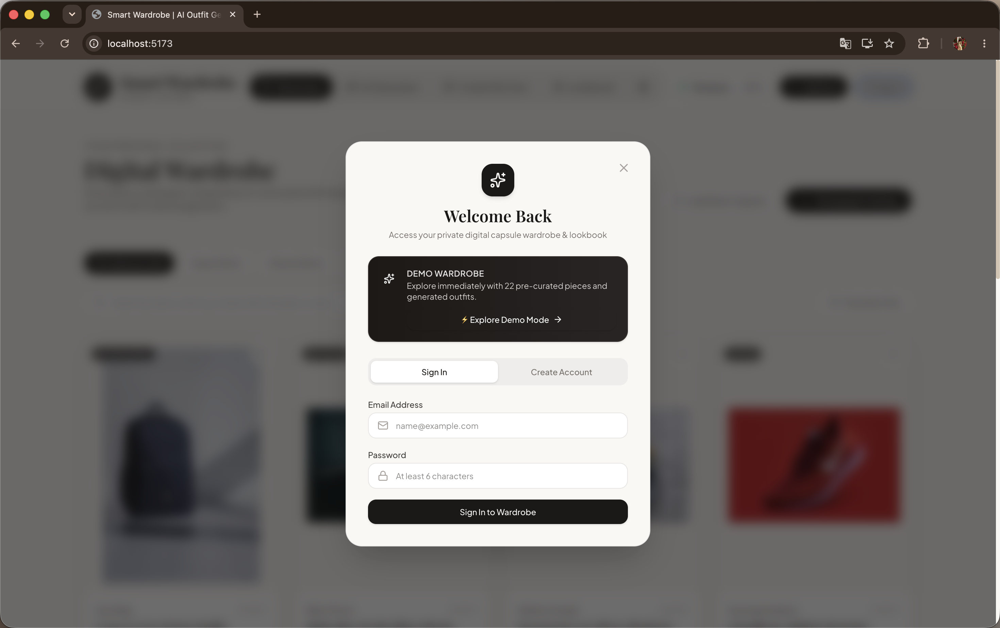
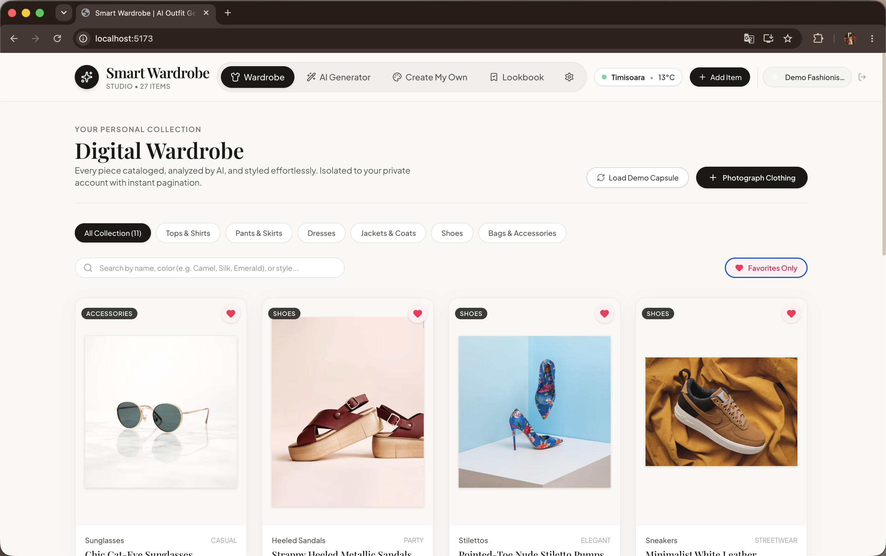
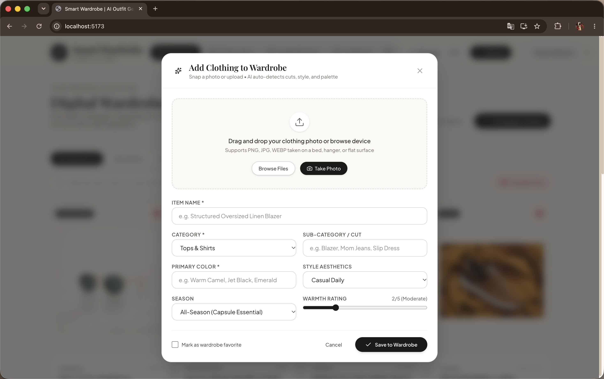
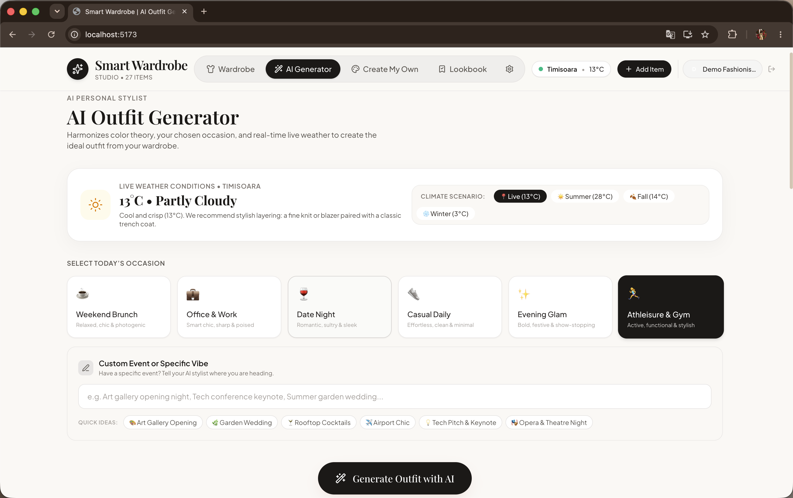
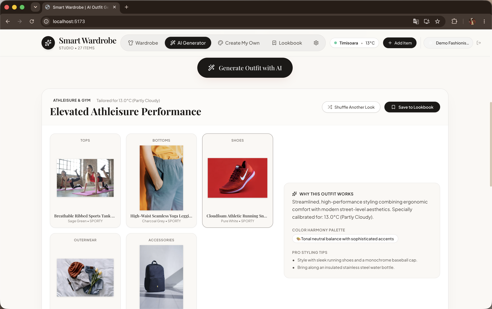
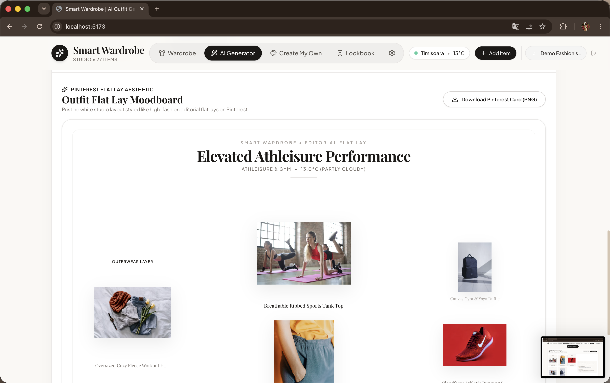
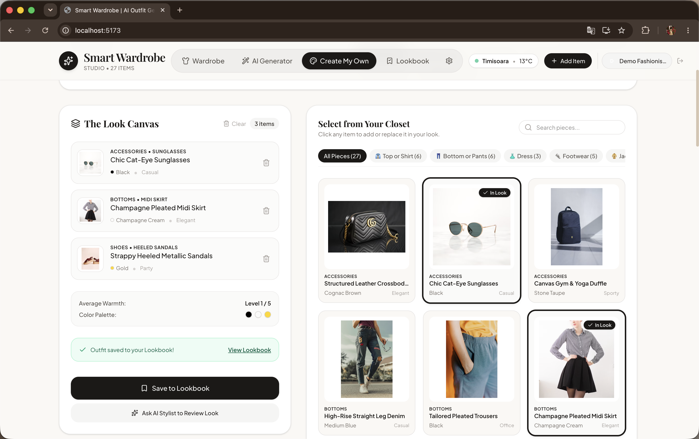
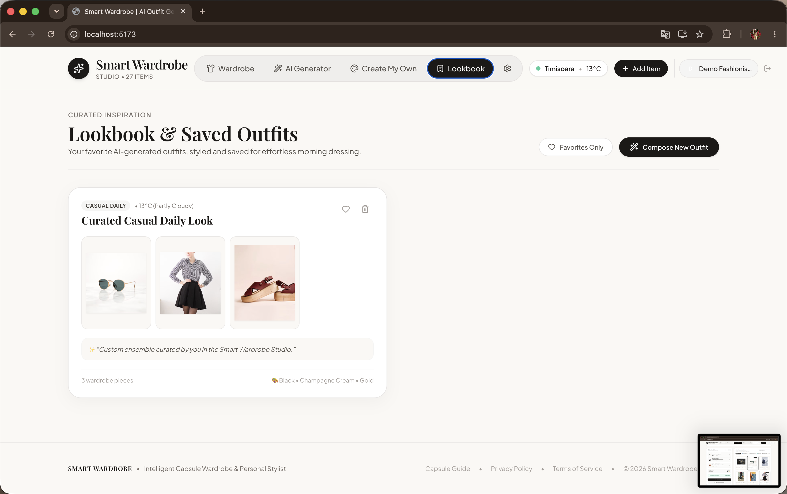

# SmartWardrobe

AI-powered digital wardrobe and context-aware outfit recommendation platform.

[](https://openjdk.org/projects/jdk/17/)
[](https://spring.io/projects/spring-boot)
[](backend/src/main/java/com/smartwardrobe/auth)
[](backend/src/main/resources/db/migration)
[](#observability--health-checks)
[](https://www.postgresql.org/)
[](https://react.dev/)
[](https://www.typescriptlang.org/)
[](https://tailwindcss.com/)
[](https://www.docker.com/)
[](#api-documentation)
[](backend/src/test)
[](LICENSE)

[GitHub Repository](https://github.com/dennysapopescu/SmartWardrobe) · [Visual Showcase](#application-showcase) · [Key Features](#key-features) · [Architecture](#architecture) · [API Documentation](#api-documentation) · [Testing & Resilience](#testing)

---

## Overview

SmartWardrobe is a full-stack digital wardrobe organization and context-aware outfit recommendation platform. It combines live meteorological data, occasion requirements, deterministic color and style scoring, and multimodal AI analysis.

Algorithmic outfit recommendation requires balancing deterministic physical constraints (ambient temperature, weather conditions, dress codes) with stylistic harmony (color theory, silhouette balance). Rather than delegating the entire recommendation workflow to an unconstrained generative model—which frequently hallucinates impractical ensembles such as formal stilettos for workouts or light dresses in sub-zero weather—SmartWardrobe implements a **two-phase hybrid architecture**:

1. **Deterministic Rule & Scoring Engine:** Filters and scores wardrobe items against weather thresholds, occasion dress codes, style affinity, and color compatibility.
2. **Multimodal LLM Layer:** Leverages Google Gemini Vision for automated item categorization upon image upload and generates stylistic reasoning for the final assembled outfit.

---

## Application Showcase

| 1. Authentication & Demo Access | 2. Digital Closet Studio |
| :---: | :---: |
|  <br> *Secure JWT login, registration, and instant 1-click recruiter demo access* |  <br> *Browse, filter by category, and search wardrobe items with server-side pagination* |

| 3. Smart Item Ingestion & AI Tagging | 4. Context-Aware Outfit Generator |
| :---: | :---: |
|  <br> *Direct camera capture/upload with client-side canvas segmentation & Gemini AI auto-tagging* |  <br> *Real-time meteorological forecasts & occasion presets (Office, Casual, Formal, Sport)* |

| 5. Scored Recommendation & AI Review | 6. Editorial Flat Lay Moodboard |
| :---: | :---: |
|  <br> *Deterministic style scoring, color harmony validation & Gemini AI stylist critique* |  <br> *High-fashion flat lay collage on white studio background with 1200x1500px PNG export* |

| 7. Custom Outfit Studio ("Create My Own") | 8. Curated Lookbook Collection |
| :---: | :---: |
|  <br> *Interactive slot builder with live warmth tracking, palette balance, and AI feedback* |  <br> *Curated collections and persistent outfit management in PostgreSQL* |

---

## Key Features

- **Multi-Tenant User Isolation & JWT Authentication:** Complete authentication lifecycle (Register, Login, BCrypt password hashing, stateless JWT Bearer tokens). Each user owns a private digital wardrobe and lookbook with strict tenant isolation.
- **⚡ Instant One-Click Demo Mode:** Recruiter-ready, zero-friction evaluation. Allows immediate full exploration of 22 curated capsule items and AI recommendations without mandatory registration.
- **Database Migrations with Flyway:** Version-controlled database evolutions (`V1__init_schema.sql`, `V2__seed_demo_data.sql`), replacing unmanaged `ddl-auto: update` with production-grade validation (`ddl-auto: validate`).
- **Observability & Health Checks (Spring Boot Actuator):** Exposed endpoints at `/actuator/health`, `/actuator/info`, and `/actuator/metrics`. Includes a custom `SmartWardrobeHealthIndicator` monitoring active clothes count, registered users, and Gemini AI connectivity.
- **Server-Side Pagination & Filtering:** Spring Data `Pageable` with responsive UI pagination controls (Page X of Y, direct page selection, debounced full-text search, and category pills).
- **Digital Closet Studio:** Categorized wardrobe browsing across Tops, Bottoms, Dresses, Outerwear, Footwear, and Accessories with real-time text search, category filters, and favorites.
- **Client-Side Image Segmentation:** Background removal executed directly in the browser via native HTML5 Canvas API prior to payload upload, reducing server load.
- **Multimodal AI Auto-Tagging:** Google Gemini Vision detects clothing category, subcategory, primary color, style, season, and warmth rating (1–5), backed by a local heuristic fallback simulator.
- **Context-Aware Recommendation Engine:** Pulls real-time meteorological forecasts via Open-Meteo to calibrate layer requirements and evaluate occasion constraints.
- **Extensible Scoring Strategy:** Uses modular scoring rules (`OccasionStyleRule`, `WeatherTemperatureRule`, `SportyFootwearRule`, `ColorHarmonyRule`) to select optimal candidates deterministically.
- **Color Compatibility Scoring:** Evaluates tonal balance and universal neutral pairings (e.g. Navy + White, Beige + Brown, Black + Red) before final selection.
- **Interactive Custom Outfit Studio ("Create My Own"):** Assemble personalized outfits piece-by-piece from wardrobe items with slot management, live warmth and palette tracking, optional AI stylist review, and one-click saving to Lookbook.
- **Pinterest-Style Editorial Flat Lay Moodboard:** Automatically generates a high-fashion flat lay collage on a pure white studio background with organic drop shadows, typography, color harmony dots, and one-click 1200x1500px PNG export.
- **Lookbook Persistence:** Save, review, and manage curated outfits in PostgreSQL.

---

## Architecture

### System Architecture

```
                  ┌──────────────────┐
                  │   React Client   │
                  │ (TypeScript/Vite)│
                  └────────┬─────────┘
                           │ REST (JWT Bearer)
                           ▼
                ┌──────────────────────┐
                │ Spring Boot Backend  │
                │(Security 6 + Actuator)│
                └──────────┬───────────┘
                           │
          ┌────────────────┼────────────────┐
          ▼                ▼                ▼
     PostgreSQL       Weather API       AI Service
    (Flyway V1/V2)    (Open-Meteo)     (Google Gemini)
                                            │
                                            ▼
                                   Editorial Explanation
```

### Recommendation Pipeline

```
       User's Wardrobe Inventory
               │
               ▼
       Weather Filtering (Temperature thresholds & precipitation)
               │
               ▼
       Occasion Detection (Presets & custom text mapping)
               │
               ▼
       Style Compatibility Scoring (Modular rule strategies & penalties)
               │
               ▼
       Candidate Outfit Selection (Valid category layers assembled)
               │
               ▼
       Gemini Multimodal Reasoning (or Local heuristic fallback)
               │
               ▼
       Final Recommendation & Editorial Styling Advice
```

---

## Tech Stack

| Layer | Technologies |
| :--- | :--- |
| **Backend** | Java 17, Spring Boot 3.3.4, Spring Data JPA, Hibernate 6, PostgreSQL 14, H2 (test profile) |
| **Security & Auth** | Spring Security 6, JJWT 0.12.6, BCrypt Password Hashing, Stateless JWT Bearer Filter |
| **Database Migrations** | Flyway 10 (`V1__init_schema.sql`, `V2__seed_demo_data.sql`), `ddl-auto: validate` |
| **Observability** | Spring Boot Actuator (`/actuator/health`, `/actuator/metrics`), Custom `SmartWardrobeHealthIndicator` |
| **API & Validation** | Spring Validation (Bean Validation), RFC-7807 Exception Envelope (`@RestControllerAdvice`), OpenAPI 3 |
| **Frontend** | React 19, TypeScript 5, Vite 6, Tailwind CSS v4, Lucide React, HTML5 Canvas API |
| **Testing & Coverage** | JUnit 5, Mockito, Spring Security Test, MockMvc, JaCoCo Coverage Reporter |
| **External APIs** | Open-Meteo API (live meteorological forecasts), Google Gemini 1.5 Flash (vision & reasoning) |
| **DevOps & CI** | Docker, Docker Compose, Nginx, GitHub Actions |

---

## API Documentation

SmartWardrobe provides interactive OpenAPI 3 (Swagger UI) documentation when running locally or in staging:

- **Swagger UI:** `http://localhost:8080/swagger-ui.html`
- **OpenAPI JSON Spec:** `http://localhost:8080/v3/api-docs`

### Key Endpoints

| Module | Method | Endpoint | Description | Auth Required |
| :--- | :--- | :--- | :--- | :--- |
| **Auth** | `POST` | `/api/auth/register` | Register a new user account | No |
| | `POST` | `/api/auth/login` | Authenticate and obtain JWT Bearer token | No |
| | `POST` | `/api/auth/demo` | Instant zero-friction demo login | No |
| **Closet** | `GET` | `/api/clothes` | Paginated, searchable, category-filtered clothes | Yes (JWT) |
| | `POST` | `/api/clothes` | Upload & register garment with AI tags | Yes (JWT) |
| | `GET` | `/api/clothes/{id}` | Retrieve garment by ID (tenant isolated) | Yes (JWT) |
| | `PATCH` | `/api/clothes/{id}/favorite` | Toggle item favorite status | Yes (JWT) |
| | `DELETE` | `/api/clothes/{id}` | Delete clothing item (tenant isolated) | Yes (JWT) |
| **Outfits** | `POST` | `/api/outfits/generate` | Generate context-aware outfit recommendation | Yes (JWT) |
| | `POST` | `/api/outfits/review-custom` | AI stylist review on custom ensemble | Yes (JWT) |
| | `POST` | `/api/outfits/save` | Save outfit to Lookbook | Yes (JWT) |
| | `GET` | `/api/outfits` | List user's saved outfits | Yes (JWT) |
| | `PATCH` | `/api/outfits/{id}/favorite` | Toggle outfit favorite status (tenant isolated) | Yes (JWT) |
| | `DELETE` | `/api/outfits/{id}` | Delete saved outfit (tenant isolated) | Yes (JWT) |
| **AI Vision** | `POST` | `/api/ai/analyze-clothing` | Multimodal garment feature extraction | Yes (JWT) |
| | `GET` | `/api/ai/status` | Current AI provider status (Gemini / Fallback) | No |
| **Weather** | `GET` | `/api/weather/current` | Live meteorological conditions via Open-Meteo | No |
| **Actuator** | `GET` | `/actuator/health` | Application & subsystem health status | No |
| | `GET` | `/actuator/metrics` | JVM, HTTP, and database operational metrics | No |

---

## Observability & Health Checks

SmartWardrobe integrates Spring Boot Actuator for health monitoring and operational metrics:

- **Health Status:** `GET /actuator/health`
- **Application Metrics:** `GET /actuator/metrics`
- **Custom Health Indicator:** `SmartWardrobeHealthIndicator` provides real-time counts of cataloged clothing items, registered user accounts, and AI integration status:

```json
{
  "status": "UP",
  "components": {
    "db": { "status": "UP", "details": { "database": "PostgreSQL", "validationQuery": "isValid()" } },
    "diskSpace": { "status": "UP" },
    "ping": { "status": "UP" },
    "smartWardrobe": {
      "status": "UP",
      "details": {
        "totalClothingItems": 22,
        "totalUsers": 1,
        "aiConfigured": true,
        "aiModel": "gemini-1.5-flash"
      }
    }
  }
}
```

---

## Running Locally

### Option 1: Docker Compose (Recommended)

1. Clone the repository and configure the environment:
   ```bash
   git clone https://github.com/dennysapopescu/SmartWardrobe.git
   cd SmartWardrobe
   cp .env.example .env
   ```
2. Build and run containers:
   ```bash
   docker compose up --build
   ```
3. Local access points:
   - **Frontend UI:** `http://localhost:5173` (or `http://localhost:80` in Docker)
   - **Backend API:** `http://localhost:8080`
   - **Swagger Docs:** `http://localhost:8080/swagger-ui.html`
   - **Actuator Health:** `http://localhost:8080/actuator/health`
   - **PostgreSQL:** `localhost:5432`

---

### Option 2: Local Development

Prerequisites: Java 17+, Node.js 20+, local PostgreSQL 14 instance (or zero-config H2 fallback).

1. **Configure Environment:**
   ```bash
   cp .env.example .env
   # Customize .env with your local credentials
   ```

2. **One-Click Startup:**
   ```bash
   ./start.sh
   ```
   *(Sources `.env`, clears occupied ports, launches Spring Boot and Vite dev servers, and cleans up on `Ctrl+C`).*

---

## Testing & Quality Assurance

The backend includes **36 automated unit, integration, and security resilience tests** with JaCoCo coverage reporting:

```bash
cd backend
./mvnw clean test
```

Coverage report generated at `backend/target/site/jacoco/index.html`.

### Test Suite Highlights (36 Tests Passing):
- **`AuthControllerTest` (3 tests):** Validates user registration, JWT login authentication, and instant one-click demo token issuance.
- **`ClothingControllerTest` (5 tests):** Validates authenticated user-scoped paginated queries, favorite toggling, standard 404 error responses, 403 Forbidden on cross-user modification, and structured RFC-7807 `ApiErrorResponse` validation envelopes.
- **`SystemResilienceAndEdgeCasesTest` (10 tests):** Comprehensive security isolation and fault tolerance tests:
  - **Multi-Tenant Wardrobe Isolation:** Verified that User A cannot modify or delete User B's clothing items (`403 Forbidden`).
  - **Multi-Tenant Lookbook Isolation:** Verified that User A cannot delete or toggle favorite on User B's saved outfits (`403 Forbidden`).
  - **Owner Authorization:** Verified that legitimate owners can update and delete their own items without obstruction.
  - **Relational Integrity on Delete:** Verified that deleting a garment cleanly unlinks associations from saved outfits before entity deletion.
  - **Weather City Resolution & Fallback:** Verified that cities are accurately mapped to geo-coordinates and external Open-Meteo timeouts fallback gracefully.
  - **Multimodal AI Fallback:** Verified that when Gemini API quota or connection fails, the system seamlessly activates rule-based advice with color palettes and tips.
  - **Wardrobe Edge Cases:** Verified that empty wardrobes trigger descriptive `IllegalStateException` messages instead of unhandled NullPointerExceptions.
- **`OutfitRecommendationServiceTest` (12 tests):** Validates style affinity, office dress code enforcement at 14°C (strict rejection of summer slip dresses in favor of tailored trousers and blazers), cold weather outerwear triggering (< 18°C), hot weather coat exclusions (> 25°C), sport occasion dress exclusion, locked items preservation, and deterministic scoring.
- **`OutfitScoringRulesTest` (5 tests):** Unit tests for `OccasionStyleRule`, `SportyFootwearRule`, `SportyApparelRule`, `WeatherTemperatureRule`, and `ColorHarmonyRule`.
- **`SmartWardrobeApplicationTests` (1 test):** Full application context and Flyway migration verification backed by an isolated H2 in-memory test database.

---

## License

This project is licensed under the terms of the [MIT License](LICENSE).
